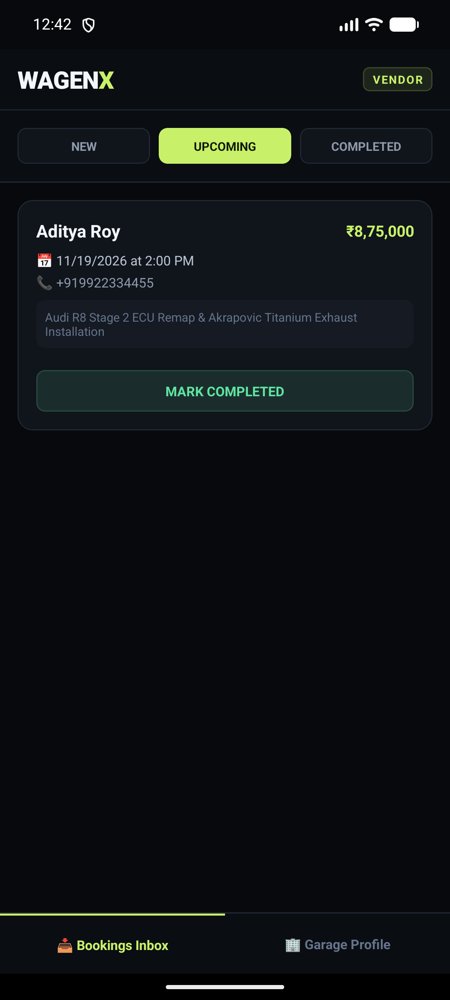
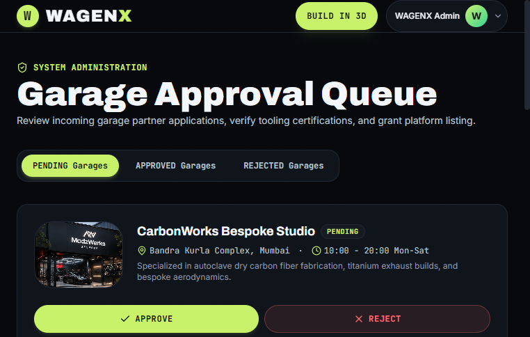
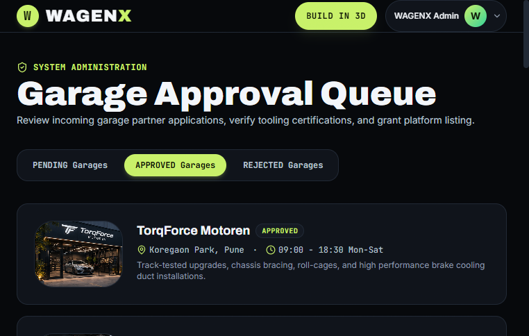

# WAGENX · Next-Gen Automotive Customization & Garage Marketplace

<div align="center">

[](https://wagenx.vercel.app)
[](https://wagenx.vercel.app/studio)
[](https://wagenx.vercel.app)
[](https://wagenx.vercel.app)
[](https://wagenx.vercel.app)

<br/>

**A full-stack, enterprise-grade automotive ecosystem combining a high-fidelity 60 FPS 3D CAD customization studio, a verified garage marketplace, a technician companion mobile app, and an administrative moderation suite.**

[Explore Live Platform](https://wagenx.vercel.app) · [3D Vehicle Studio](https://wagenx.vercel.app/studio) · [Garage Network](https://wagenx.vercel.app/garages) · [Performance Store](https://wagenx.vercel.app/accessories)

</div>

---

## 📌 Executive Summary

**WagenX** transforms the automotive aftermarket and customization industry into a unified, digital-first experience. By replacing traditional catalog-based booking with an interactive **WebGL 3D CAD Configurator**, customers can design, style, and visualize custom vehicle builds in real time. 

The custom build state (paint finish, wheel style, brake calipers, ground-effect neon glow) seamlessly injects into a verified **Garage Marketplace & Booking Wizard**, matching car enthusiasts with top-tier performance tuning workshops. The ecosystem is bridged by a **React Native Technician Companion App** for garage workflow management and a secured **Admin Moderation Dashboard** for platform governance.

---

## 🏗️ System Architecture Overview

```
                                  +------------------------------------------+
                                  |            CLIENT ECOSYSTEM              |
                                  +------------------------------------------+
                                       |                  |                |
                +----------------------+                  |                +-----------------------+
                |                                         |                                        |
                v                                         v                                        v
   +--------------------------+              +--------------------------+             +--------------------------+
   |   CUSTOMER WEB PORTAL    |              |   3D WEBGL STUDIO        |             |  GARAGE TECHNICIAN APP   |
   |   React 18 + TypeScript  |              |   Three.js + PBR Engine  |             |  React Native + Expo     |
   |   TailwindCSS + TanStack |              |   60 FPS Real-time CAD   |             |  Android / iOS Companion |
   +--------------------------+              +--------------------------+             +--------------------------+
                |                                         |                                        |
                |   REST / JSON                           | Custom Build State                     | REST / Mobile Sync
                +--------------------+                    | (Injected to Wizard)                   |
                                     |                    |                                        |
                                     v                    v                                        v
                            +--------------------------------------------------+
                            |           ADMIN MODERATION DASHBOARD             |
                            |           Role-Based Access Control (RBAC)       |
                            |           JWT Authentication Engine              |
                            +--------------------------------------------------+
                                                      |
                                                      | Secure HTTPS API
                                                      v
                                    +------------------------------------+
                                    |    ENTERPRISE BACKEND SERVICE      |
                                    |    Spring Boot 3.3.5 / Java 17     |
                                    |    Spring Security + JWT Auth      |
                                    |    Spring Data JPA / Hibernate     |
                                    |    Containerized via Docker        |
                                    +------------------------------------+
                                                      |
                                                      | Connection Pooling
                                                      v
                                    +------------------------------------+
                                    |    SERVERLESS CLOUD DATABASE       |
                                    |    Neon PostgreSQL (v18.7)         |
                                    |    Flyway Schema Versioning        |
                                    |    9 Relational Entities           |
                                    +------------------------------------+
```

---

## 🚀 Key Platform Modules

### 1. 🏎️ 3D WebGL Vehicle Configurator Studio
An in-browser CAD studio engineered with **Three.js** running at a locked **60 FPS** with physical-based rendering (PBR):
* **Multi-Vehicle Support:** Real-time geometry swapping between sports cars (Audi R8, Porsche 911) and luxury SUVs (Range Rover).
* **Material & Paint Shaders:** Interactive car livery customization with dynamic roughness, metalness, and clearcoat channels (Gloss, Satin Matte, Metallic flake).
* **Wheel & Caliper Hub:** Dynamic wheel mesh swapping with custom rim finishes and heat-resistant brake caliper recoloring.
* **Underglow & Environmental Lighting:** Ground-effect neon lighting system with dynamic spot/point light casting and customizable HDRI environments (Studio, Neon Cyber, Sunset Golden Hour, Industrial Garage).
* **Camera Rigging:** Cinematic and orthographic CAD perspectives (`3/4 View`, `Front`, `Side Profile`, `Rear View`, `Wheel Close-up`, `Top-down Blueprint`).
* **Direct Booking Sync:** One-click transition that encodes the 3D custom configuration and passes it directly into the service booking wizard.

### 2. 🏪 Customer Marketplace & Booking Engine
* **Curated Garage Network:** Browse and filter certified performance workshops by location, customer rating, and specialty services (ECU tuning, aerodynamic wraps, exhaust fabrication, suspension setup).
* **Performance Accessories Store:** High-end aftermarket components catalog with live pricing, technical specifications, and category filtering.
* **Smart Booking Wizard:** A multi-step appointment scheduler that pairs customer vehicles, selected modification services, and preferred dates with certified workshops.

### 3. 📱 Mobile Technician & Garage Companion App
* Engineered with **React Native** and **Expo** for on-the-ground workshop management.
* **Live Job Dispatch:** Real-time inbox for garage owners and mechanics to inspect incoming customer bookings and custom 3D build specifications.
* **Order Status Management:** Transition vehicle jobs between `Pending Review`, `Confirmed`, `In Workshop`, and `Completed`.
* **Edge-to-Edge Dark Mode:** High-contrast ergonomic UI tailored for tablet and mobile screens in garage workshop environments.

<div align="center">
  
  <p><i>Figure 1: React Native Mobile Companion App for Workshop Technicians</i></p>
</div>

### 4. 🛡️ Admin Operations & Moderation Suite
* **Role-Based Access Control (RBAC):** Secured with `ROLE_ADMIN` JWT tokens and Spring Security endpoint interceptors.
* **Workshop Verification Pipeline:** Automated audit queue allowing platform administrators to review new garage applications, inspect credentials, and grant the official "Verified Workshop" badge.
* **Real-time Status Toggle:** Instant activation and suspension controls for garages and marketplace catalog items.

<div align="center">
  
  <p><i>Figure 2: Admin Moderation Queue for Reviewing Pending Workshops</i></p>
  <br/>
  
  <p><i>Figure 3: Verified Partner Garage Activated in Platform Catalog</i></p>
</div>

---

## 🛠️ Technology Stack & Engineering Specifications

| Layer | Technologies & Tools | Capabilities |
|---|---|---|
| **3D Engine** | Three.js, WebGL 2.0, GLTF Loader, OrbitControls | PBR Materials, 60 FPS rendering, dynamic lighting, camera animation |
| **Frontend Web** | React 18, TypeScript, TailwindCSS, TanStack Query, Vite | Responsive mobile-first ergonomics, reactive state management |
| **Mobile App** | React Native, Expo, React Navigation, Axios | Edge-to-edge UI, secure token storage, technician dispatch flow |
| **Backend API** | Spring Boot 3.3.5, Java 17, Spring Security, Spring Data JPA | RESTful architecture, JWT authentication, stateless session design |
| **Database** | Neon Serverless PostgreSQL 18.7, Flyway Migrations | Automated schema migrations, connection pooling, ACID transactional integrity |
| **DevOps & Cloud** | Docker, Render Cloud Compute, Vercel Edge CDN | Micro-containerization, edge distribution, automated telemetry keep-alive |

---

## 📊 Relational Database Topology (Neon PostgreSQL)

The backend persists state across 9 core relational tables managed by Flyway versioning:

```
+--------------------+       +-----------------------+       +---------------------+
|       USERS        |       |        GARAGES        |       |      PRODUCTS       |
+--------------------+       +-----------------------+       +---------------------+
| id (PK)            |<--+   | id (PK)               |<--+   | id (PK)             |
| email (Unique)     |   |   | name                  |   |   | title               |
| password_hash      |   |   | location / city       |   |   | category            |
| role (USER/ADMIN)  |   |   | rating / review_count |   |   | price               |
| created_at         |   |   | verified (boolean)    |   |   | in_stock            |
+--------------------+   |   +-----------------------+   |   +---------------------+
                         |               |               |
                         |               | 1:N           |
                         |               v               |
                         |   +-----------------------+   |
                         |   |    GARAGE_SERVICES    |   |
                         |   +-----------------------+   |
                         |   | id (PK)               |   |
                         |   | garage_id (FK)        |   |
                         |   | service_name          |   |
                         |   | price_estimate        |   |
                         |   +-----------------------+   |
                         |                               |
                         +---------------+---------------+
                                         |
                                         v
                         +-------------------------------+
                         |           BOOKINGS            |
                         +-------------------------------+
                         | id (PK)                       |
                         | user_id (FK)                  |
                         | garage_id (FK)                |
                         | vehicle_model                 |
                         | build_configuration_json      |
                         | appointment_date              |
                         | status (PENDING/CONFIRMED)    |
                         +-------------------------------+
```

---

## 🌐 Live Platform Access

The customer web portal and 3D Studio are publicly accessible at:

🔗 **[https://wagenx.vercel.app](https://wagenx.vercel.app)**

> [!NOTE]
> **Architecture & Showcase Repository:** This repository serves as the public architectural case study and visual portfolio for the **WagenX** platform. Proprietary source code (Spring Boot microservices, proprietary WebGL shaders, React Native enterprise repositories, and database connection strings) is maintained in a private organization repository to safeguard intellectual property.

---

<div align="center">
  <sub>Designed & Developed for Automotive Enthusiasts · Powered by Three.js & Spring Boot</sub>
</div>
